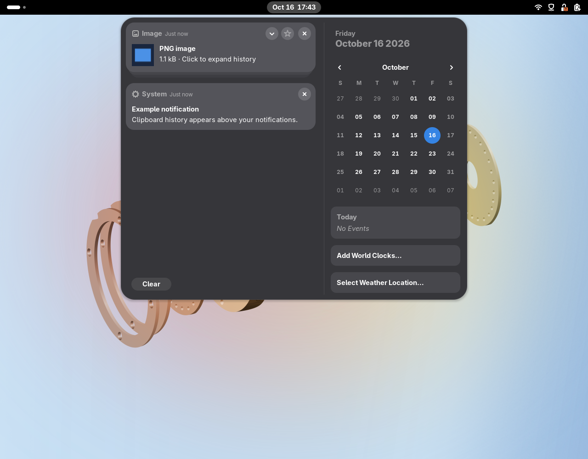
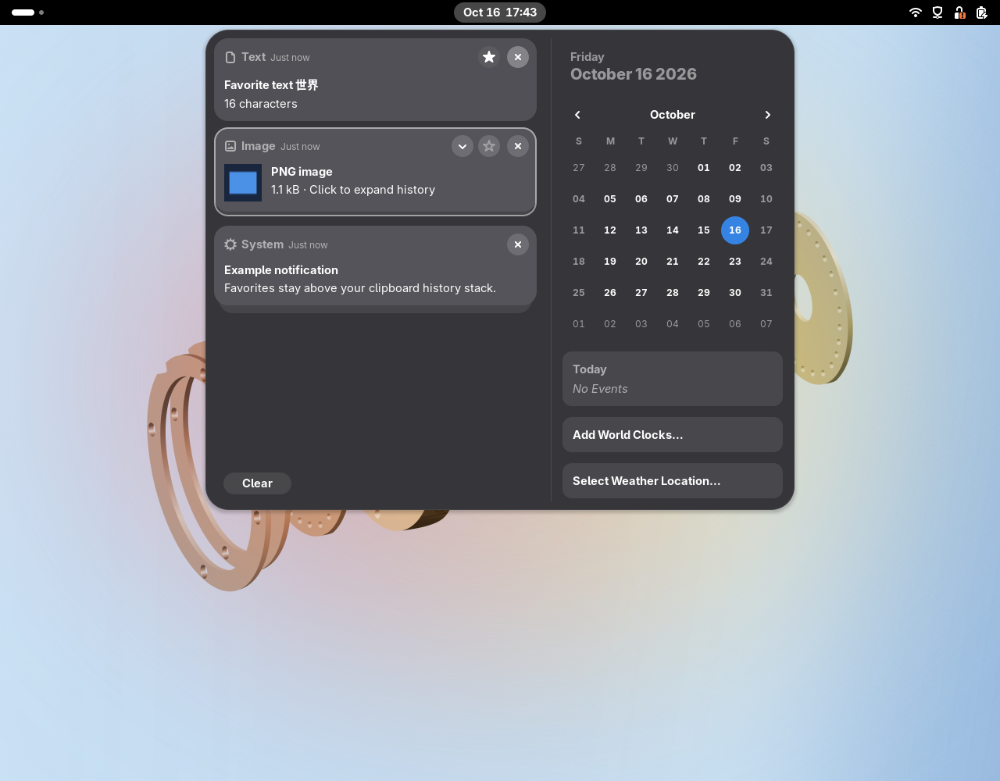

# Clipboard Center

A native GNOME Shell 51 clipboard manager inside the clock/calendar menu.
Clipboard cards sit **above the notification stack**, using GNOME's own message
widgets and your Shell theme.



- Copy and restore text and images, including screenshots.
- Click the stack to expand history, then click a card to copy its original content.
- Star favorites to keep them as standalone cards above the collapsed stack.
- Browse or search history, and scroll without a visible scrollbar. Expand an image for a larger preview.
- Page through expanded stacks 10 items at a time with Previous/Next buttons.
- Remove individual entries, or pause recording in preferences.
- Configure the regular history limit (5–200 items; default 50) and image capture.
- Keep text, images, and favorites across screen lock, logout, and reboot.
- Works with Wayland through Mutter's clipboard selection API.



History and favorites are saved locally in `~/.local/share/clipboard-center/history.gv`
(or under `$XDG_DATA_HOME` if set). The directory and file are accessible only to
your account; the data is not encrypted. Nothing is sent over the network.
Removing or clearing entries also updates saved history.
Content marked sensitive by a password manager is skipped; unmarked secrets
can still be recorded. Pause before copying sensitive content.

## Install

Requires GNOME Shell **51**, `gnome-extensions`, and `glib-compile-schemas`.

```sh
bash scripts/install.sh
```

For a new installation, **log out and back in** so GNOME discovers the extension.
Click the clock in the top bar to find Clipboard above your notifications.
The installer enables the extension for your next login.

Alternatively, install the built bundle:

```sh
gnome-extensions install --force dist/clipboard-center@stone.dev.shell-extension.zip
```

After logging in, if necessary:

```sh
gnome-extensions enable clipboard-center@stone.dev
```

Open preferences through the Extensions app, or:

```sh
gnome-extensions prefs clipboard-center@stone.dev
```

## Development

The extension has no runtime package dependencies. Bun and Biome are development tools only.
The storage tests also require `gjs` to exercise real GNOME file I/O in separate processes.

```sh
bun install --frozen-lockfile
bun run check
bun run build
bun run test:shell
```

`test:shell` starts a separate headless GNOME compositor and D-Bus session. It
tests real clipboard capture, native cards, search, image restoration, and
enable/disable cleanup. It leaves logs and a screenshot under the printed
`/tmp/clipboard-center-test.*` directory. Requires Python with PyGObject and
`wl-clipboard` for external Wayland copy/paste checks.
It does not enable debugging or alter extensions in your desktop session.

The package is written to `dist/clipboard-center@stone.dev.shell-extension.zip`.
Only GNOME entry points, source, stylesheet, metadata, and schemas are bundled.

See [architecture](docs/design/architecture.md), [setup](docs/implementation/setup.md),
and [usage](docs/user/usage.md).
